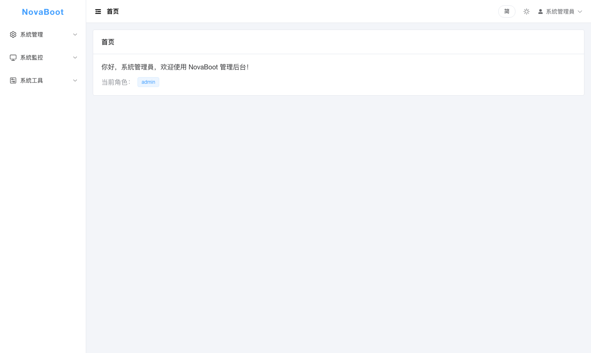
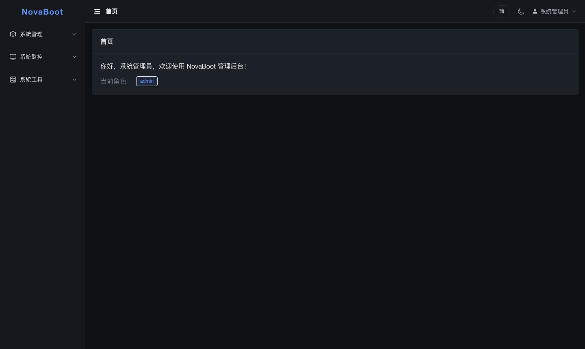
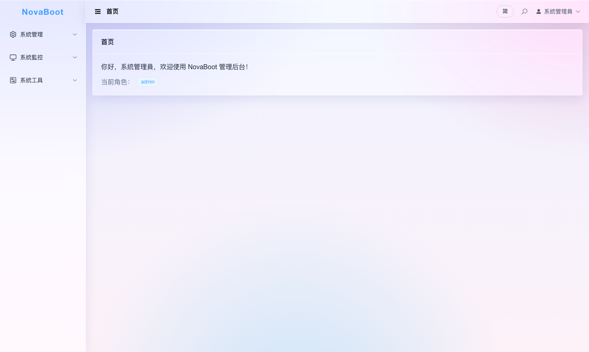
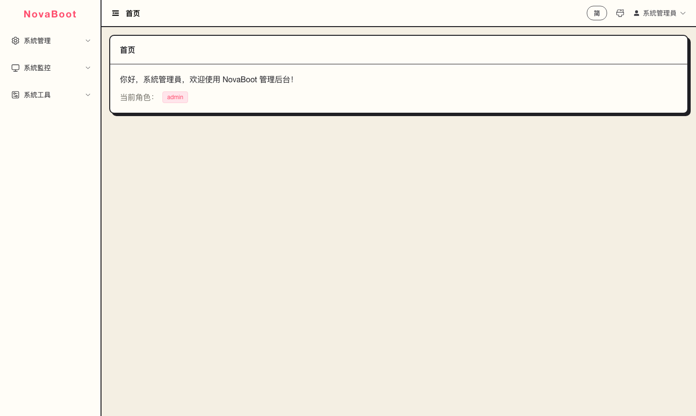
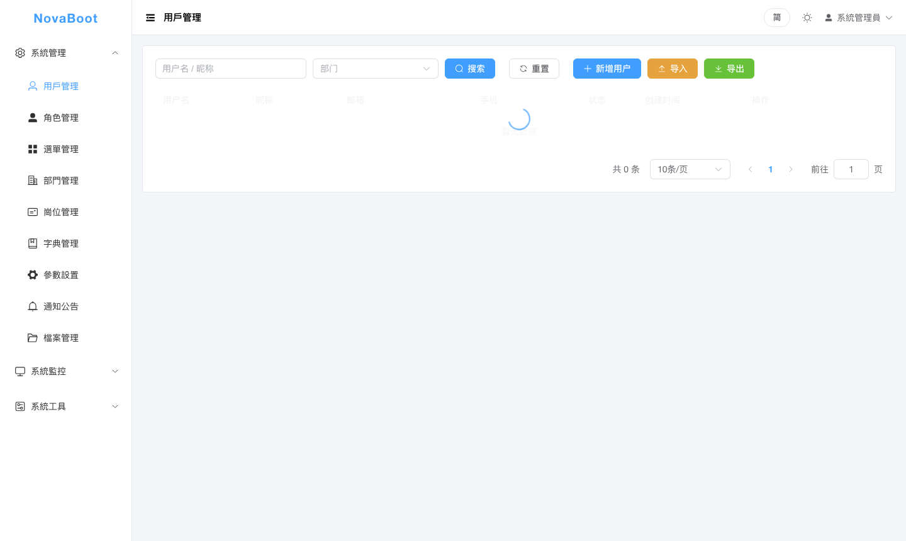
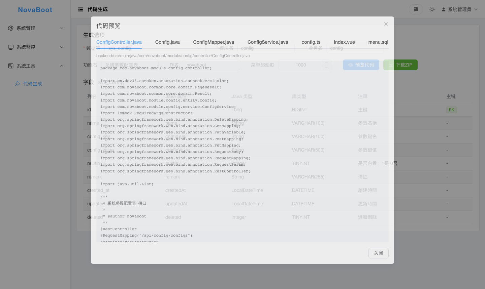
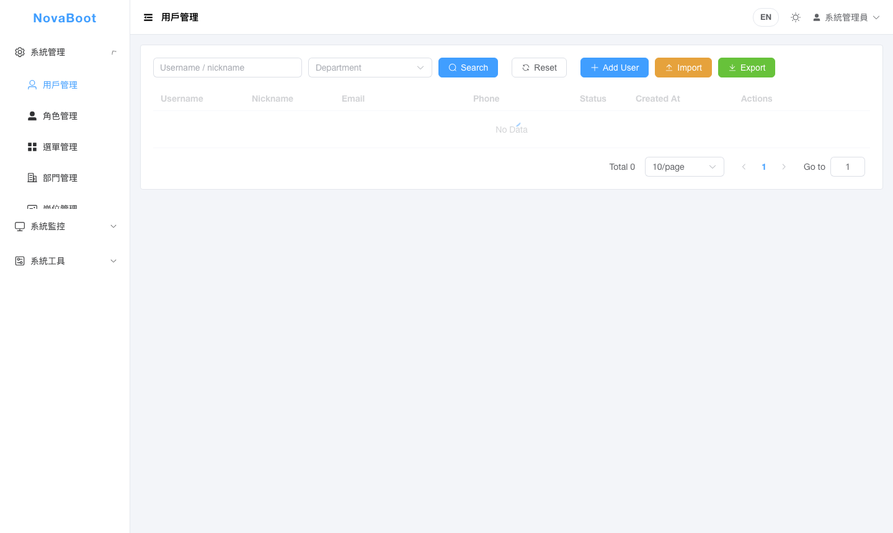
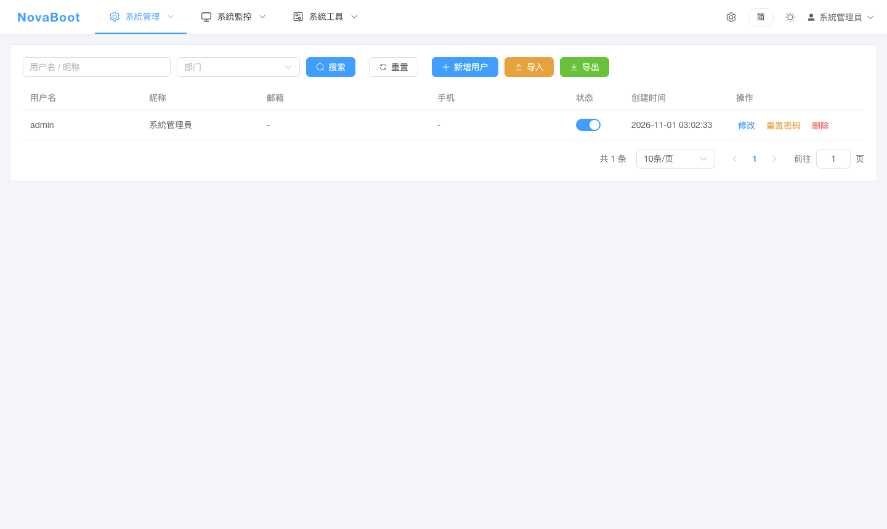
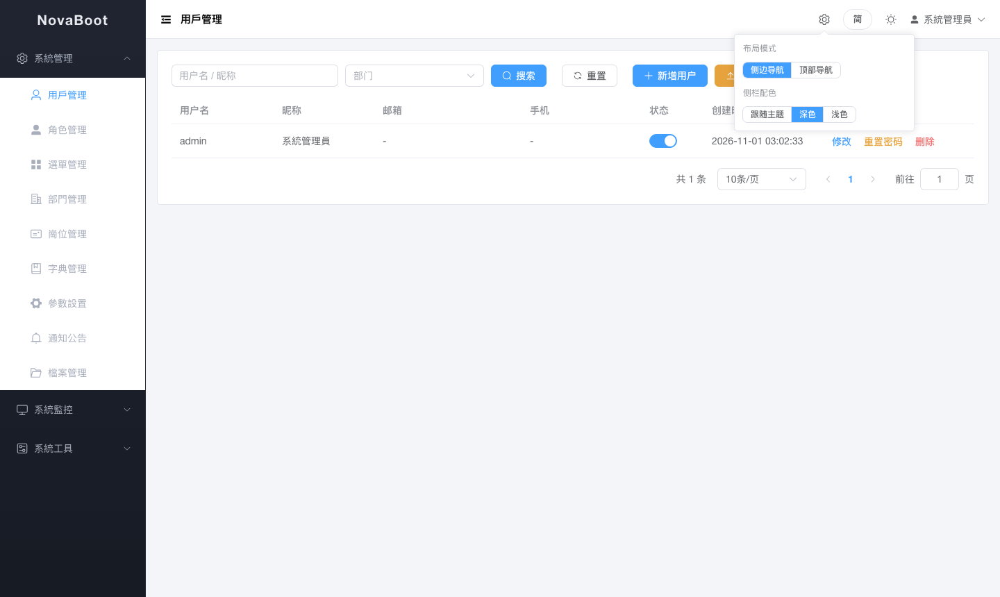

# NovaBoot

一套開箱即用的開源企業級 Web 應用基礎框架：內置用戶、角色、選單（RBAC 權限體系）等後台系統標配能力，前後端分離，MIT 協議。

> 當前狀態：**v1.0.0**（M0 骨架 + M1 系統模組 + M2 交付：代碼生成器、Excel、監控、Docker、文檔站；M3 首批：AI/郵件 Starter；四主題、三語言）。
> 技術選型與總體方案見 [docs/01-技術選型與總體方案.md](docs/01-技術選型與總體方案.md)。

## 界面預覽

| 亮色主題 | 暗色主題 |
|---|---|
|  |  |
| **液態玻璃主題** | **漫畫主題** |
|  |  |

| 用戶管理（含 Excel 導入導出） | 代碼生成器（在線預覽） | English 界面 |
|---|---|---|
|  |  |  |
| **頂部導航模式** | **側邊導航 + 深色側欄** | |
|  |  | |

> 更多截圖見 [docs/screenshots/](docs/screenshots/)（含登入頁、生成器主頁面等）。佈局模式與側欄配色在頂欄 ⚙ 設置中切換，localStorage 持久化。

## 技術棧

| 層 | 選型 |
|---|---|
| 後端 | JDK 21+（推薦 25 LTS）· Spring Boot 4.1 · Sa-Token · MyBatis-Plus · Flyway · MySQL 8.4 / H2 |
| 前端 | Vue 3.5 · TypeScript · Vite · Element Plus · Pinia · UnoCSS（pnpm monorepo） |
| 工程 | Maven 多模組 · Spring Boot Starter 式模組邊界 · GitHub Actions（待接入） |

## 快速開始（後端）

```bash
# 默認 local profile：H2 內存庫 + 內存會話，零外部依賴啟動
cd nova-server-admin
mvn package -DskipTests
mvn spring-boot:run                  # 端口 8080
```

- 默認賬號：`admin`，初始密碼見 `application.yml` 的 `nova.init.admin-password`
- 介面文檔：<http://localhost:8080/swagger-ui.html>
- 切換 MySQL + Redis：`--spring.profiles.active=mysql`（先複製 `application-mysql.example.yml` 為同目錄 `application-mysql.yml` 並填入你的連接信息，該文件已 gitignore 不會入庫；也可通過 `MYSQL_*` / `REDIS_*` 環境變量注入。建表與種子數據由 Flyway 自動執行，會話/驗證碼/在線用戶存 Redis）

## 快速開始（前端）

```bash
cd web
pnpm install
pnpm dev     # 開發模式，/api 代理到 localhost:8080
pnpm build   # 產物在 web/apps/admin/dist
```

## 模組結構

```
nova-boot/
├─ nova-dependencies/       # 三方依賴版本 BOM
├─ nova-common/             # 統一響應、分頁、異常、錯誤碼
├─ nova-framework/          # Web / Sa-Token / MyBatis-Plus / 驗證碼 / 全局異常
├─ nova-module-system/      # 系統模組：用戶、角色、選單（RBAC）
├─ nova-module-generator/   # 代碼生成器（M2）
├─ nova-starter-ai/         # M3 生態：OpenAI 兼容 LLM 網關 Starter
├─ nova-starter-mail/       # M3 生態：郵件發送 Starter
├─ nova-server-admin/       # 後台服務啟動器（Flyway 腳本在此）
├─ web/                     # 前端 pnpm monorepo（apps/admin）
└─ docs-site/               # VitePress 文檔站（docs-site）
```

## 路線圖

- [x] M0 骨架：登入/驗證碼、用戶/角色/選單、動態路由、按鈕權限
- [x] M1 系統模組：部門崗位、字典參數、通知公告、日誌審計、在線用戶、資料權限、檔案上傳（本地存儲）
- [x] M2 效率與交付：代碼生成器、Excel 導入導出、Redis 會話、監控（Actuator + Prometheus）、Docker 一鍵部署、文檔站、v1.0.0
- [x] M3 生態（首批）：AI Starter（LLM 網關）、郵件 Starter；多租戶、工作流、插件機制按模組持續演進

## 部署

- Docker 一鍵啟動（MySQL + Redis + 後端 + 前端 Nginx）：`cp .env.example .env && docker compose up -d --build`，詳見 [deploy/README.md](deploy/README.md)
- 監控：`/actuator/health` 公開；`/actuator/prometheus` 需登入 Token（Prometheus 抓取配置 Bearer Token 即可）
- 文檔站：`cd docs-site && pnpm install && pnpm run docs:dev`

## 協議

MIT
